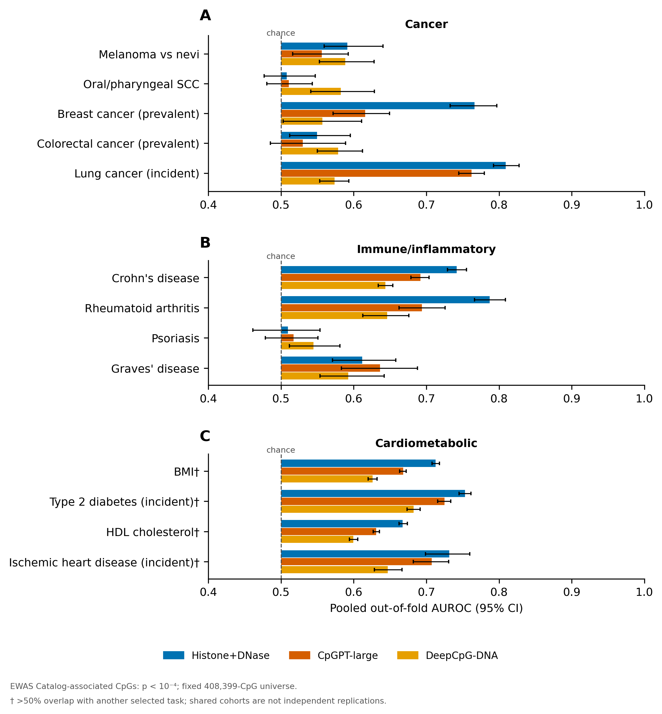

# EWAS-v3: approved panel results

Execution complete: **39 main endpoint rows**, **39 paired AUROC contrasts**; primary p < 1e-4, EWAS Catalog-associated CpGs. Frozen panel: 13 tasks, Cancer 5, immune/inflammatory 4, cardiometabolic 4. Source and task selection were fixed before evaluation.

All three stores passed SHA256/dimension checks and full 408,399-locus coverage. All main matched pairs are shared across representations. Scalers are fitted only to each inner/outer training partition; nested L2 logistic probe, five chromosome folds, seed 17. CI: 1,000 paired chromosome bootstrap draws. Concordance is strict positive > background (ties zero). AUPRC is descriptive because of the matched 50% prevalence.

## Main absolute AUROC (95% chromosome-bootstrap CI)

| Category | Trait / endpoint | Regulatory 256D | CpGPT 512D | DeepCpG 128D |
|---|---|---:|---:|---:|
| Cancer | Cutaneous melanoma versus nevi | 0.591 [0.559, 0.640] | 0.556 [0.516, 0.592] | 0.589 [0.553, 0.628] |
| Cancer | Oral or pharyngeal squamous cell carcinoma | 0.508 [0.477, 0.547] | 0.511 [0.481, 0.543] | 0.582 [0.541, 0.629] |
| Cancer | Prevalent Breast Cancer (Self-report) | 0.766 [0.733, 0.797] | 0.616 [0.572, 0.649] | 0.557 [0.503, 0.611] |
| Cancer | Prevalent Colorectal Cancer (Self-report) | 0.550 [0.512, 0.596] | 0.530 [0.485, 0.589] | 0.579 [0.550, 0.612] |
| Cancer | Incident Lung Cancer | 0.809 [0.792, 0.827] | 0.762 [0.745, 0.780] | 0.574 [0.553, 0.594] |
| Immune/inflammatory | Crohn's disease | 0.742 [0.729, 0.755] | 0.692 [0.679, 0.704] | 0.644 [0.634, 0.654] |
| Immune/inflammatory | Rheumatoid arthritis | 0.787 [0.766, 0.809] | 0.694 [0.663, 0.726] | 0.646 [0.613, 0.676] |
| Immune/inflammatory | Psoriasis | 0.509 [0.461, 0.554] | 0.517 [0.479, 0.551] | 0.545 [0.512, 0.581] |
| Immune/inflammatory | Graves' disease | 0.612 [0.571, 0.658] | 0.636 [0.583, 0.688] | 0.592 [0.554, 0.642] |
| Cardiometabolic | Body mass index | 0.713 [0.708, 0.718] | 0.668 [0.663, 0.672] | 0.626 [0.620, 0.632] |
| Cardiometabolic | Incident Type 2 Diabetes | 0.753 [0.745, 0.761] | 0.725 [0.715, 0.734] | 0.683 [0.674, 0.692] |
| Cardiometabolic | HDL cholesterol | 0.667 [0.662, 0.674] | 0.631 [0.627, 0.635] | 0.599 [0.594, 0.606] |
| Cardiometabolic | Incident Ischemic Heart Disease | 0.732 [0.699, 0.760] | 0.708 [0.682, 0.731] | 0.647 [0.628, 0.666] |

Figure markers † indicate >50% shared smaller positive set. The five flagged cardiometabolic pairs remain selected and cannot be interpreted as independent replications. Shared-source registry records repeated PMIDs and archival deposits separately: a bulk archive can contain independent studies. Selected endpoints with the same PMID may share participants; positive-set overlap alone does not establish cohort independence. No numerical participant overlap is inferred. No category AUROC averages or category win counts are calculated.

## Sensitivities and limitations

Both the frozen genomic-context sensitivity and p < 1e-7 sensitivity were executed for the same sources/representations. Across four design/threshold combinations, **138 endpoint rows are evaluated** and **18 rows are not_evaluable**. The latter correspond to melanoma, colorectal cancer and psoriasis at p < 1e-7, across both matching designs and all three arms: fewer than five occupied chromosome folds. No replacement CV or tasks were introduced. Eight tasks have <100 strict-threshold positives and retain insufficient_support labels.

Non-converged fits: **0**. AUPRC uses standard grouped ties; the inherited row-order AP defect is uniformly corrected from saved OOF scores, without fitting new models or changing AUROC/contrasts. Correction diagnostics are provided. All 39 main paired contrasts are available; bootstrap p-values are descriptive and unadjusted.

Provenance: official EWAS Catalog Zenodo fallback; full current Catalog coverage remains incomplete, and actual Catalog StudyIDs are unavailable. Source analysis IDs, filenames, Zenodo records, PMIDs and hashes remain in the frozen manifest. The manuscript should describe these tasks as prediction of Catalog-associated CpGs, with tissue/sample-size differences recorded, rather than causal validation.

## Artifacts

- Tidy main table: `data/registry/ewas_v3_results/main_results.csv`.
- Paired contrasts: `data/registry/ewas_v3_results/main_paired_contrasts.csv`.
- All sensitivity endpoint/contrast rows: `all_results.csv` and `all_paired_contrasts.csv` in the same directory.
- Completion audit, environment and execution/store/code provenance are versioned in the same directory.
- Canonical publication figures: `paper/figures/fig3_ewas.pdf` and `.png`; the EWAS-v2 plot is replaced. Identical copies are retained in `docs/figures/ewas_v3_main_auroc.*` and the experiment output directory.
- Per-fold checkpoints and OOF scores remain in `outputs/ewas_v3/ewas-v3-main-panel-freeze-v1/`.
- Panel freeze commit: `640fdb5`; approval/runner commit: `44cf265`.
